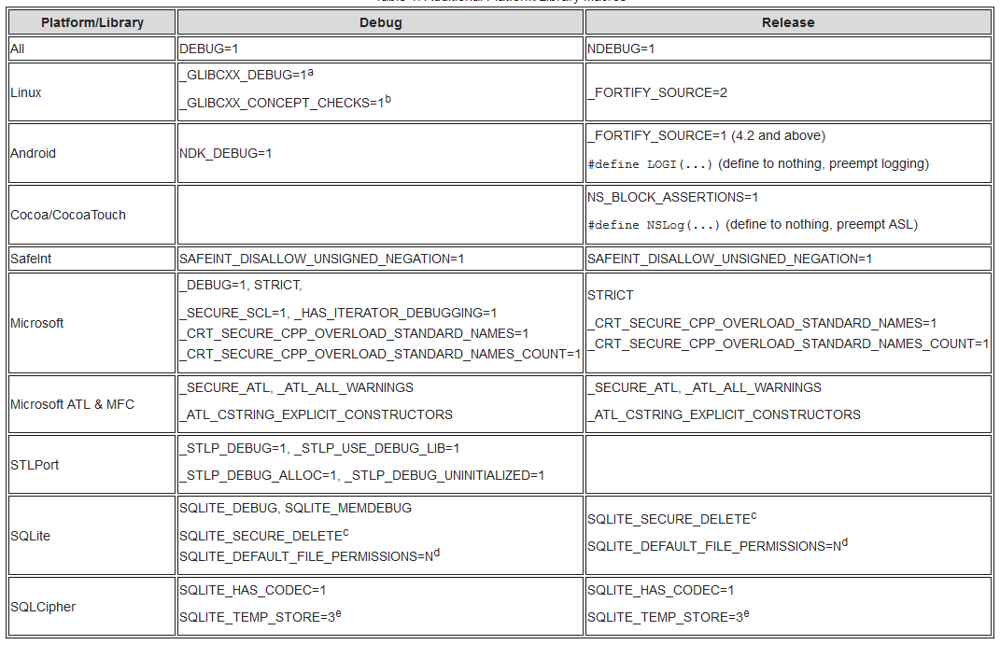
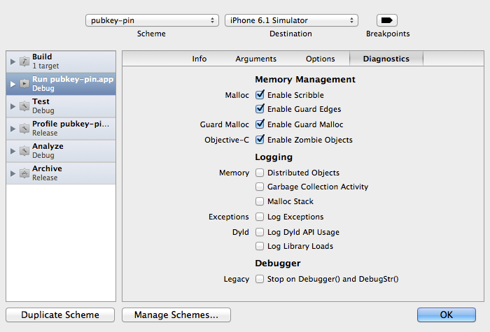
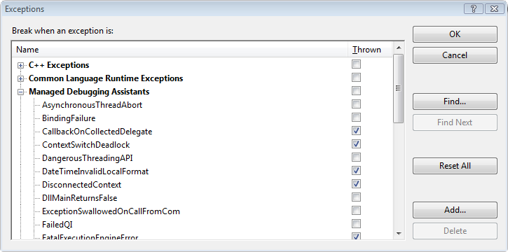
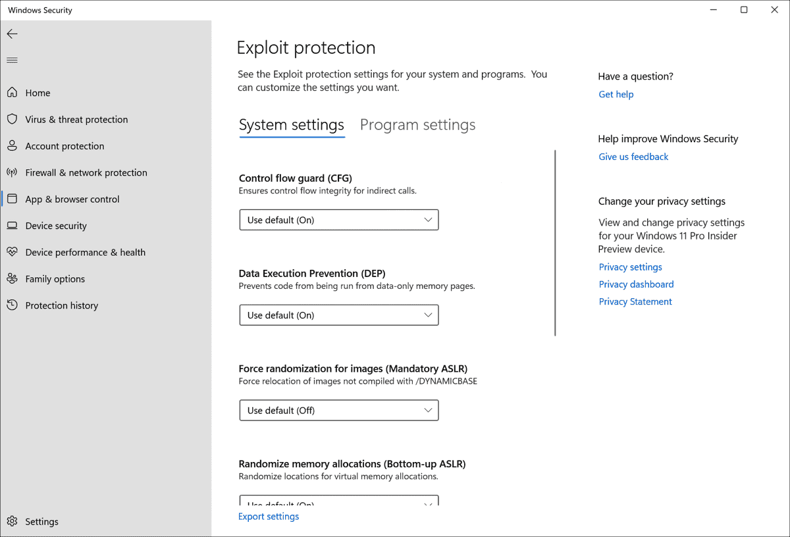

# C-Based Toolchain Hardening Cheat Sheet

## Introduction

C-Based Toolchain Hardening is a treatment of project settings that will help you deliver reliable and secure code when using C, C++ and Objective C languages in a number of development environments. This article will examine Microsoft and GCC toolchains for the C, C++ and Objective C languages. It will guide you through the steps you should take to create executables with firmer defensive postures and increased integration with the available platform security. Effectively configuring the toolchain also means your project will enjoy a number of benefits during development, including enhanced warnings and static analysis, and self-debugging code.

There are four areas to be examined when hardening the toolchain: configuration, preprocessor, compiler, and linker. Nearly all areas are overlooked or neglected when setting up a project. The neglect appears to be pandemic, and it applies to nearly all projects including Auto-configured projects, makefile-based, Eclipse-based, Visual Studio-based, and Xcode-based. It's important to address the gaps at configuration and build time because it's difficult to impossible to [add hardening on a distributed executable after the fact](https://sourceware.org/ml/binutils/2012-03/msg00309.html) on some platforms.

This is a prescriptive article, and it will not debate semantics or speculate on behavior. Some information, such as the C/C++ committee's motivation and pedigree for [`program diagnostics`, `NDEBUG`, `assert`, and `abort()`](https://groups.google.com/a/isocpp.org/forum/?fromgroups=#!topic/std-discussion/ak8e1mzBhGs), appears to be lost like a tale in the Lord of the Rings. As such, the article will specify semantics (for example, the philosophy of 'debug' and 'release' build configurations), assign behaviors (for example, what an assert should do in 'debug' and 'release' build configurations), and present a position. If you find the posture is too aggressive, then you should back off as required to suit your taste.

A secure toolchain is not a silver bullet. It is one piece of an overall strategy in the engineering process to help ensure success. It will complement existing processes such as static analysis, dynamic analysis, secure coding, negative test suites, and the like. Tools such as Valgrind and Helgrind will still be needed, and a project will still require solid designs and architectures.

The OWASP [ESAPI C++](https://code.google.com/p/owasp-esapi-cplusplus/source) project eats its own dog food. Many of the examples you will see in this article come directly from the ESAPI C++ project.

## Wisdom

Code **must** be correct. It **should** be secure. It **can** be efficient.

[Dr. Jon Bentley](https://en.wikipedia.org/wiki/Jon_Bentley): _"If it doesn't have to be correct, I can make it as fast as you'd like it to be"_.

[Dr. Gary McGraw](https://en.wikipedia.org/wiki/Gary_McGraw): _"Thou shalt not rely solely on security features and functions to build secure software as security is an emergent property of the entire system and thus relies on building and integrating all parts properly"_.

## Configuration

Configuration is the first opportunity to configure your project for success. Not only do you have to configure your project to meet reliability and security goals, you must also configure integrated libraries properly. You typically have three choices. First, you can use auto-configuration utilities if on Linux or Unix. Second, you can write a makefile by hand. This is predominant on Linux, macOS, and Unix, but it applies to Windows, as well. Finally, you can use an integrated development environment or IDE.

### Build Configurations

At this stage in the process, you should concentrate on configuring for two builds: Debug and Release. Debug will be used for development and include full instrumentation. Release will be configured for production. The difference between the two settings is usually _optimization level_ and _debug level_. A third build configuration is Test, and it's usually a special case of Release.

For debug and release builds, the settings are typically diametrically opposed. Debug configurations have no optimizations and full debug information, while Release builds have optimizations and minimal to moderate debug information. In addition, debug code has full assertions and additional library integration, such as mudflaps and malloc guards such as `dmalloc`.

The Test configuration is often a Release configuration that makes everything public for testing and builds a test harness. For example, all member functions that are public (C++ class) and all interfaces (library or shared object) should be made available for testing. Many Object Oriented purists oppose testing private interfaces, but this is not about object oriented-ness. This (_q.v._) is about building reliable and secure software.

[GCC 4.8](https://gcc.gnu.org/gcc-4.8/changes.html) introduced an optimization of `-Og`. Note that it is only an optimization, and still requires a customary debug level via `-g`.

#### Debug Builds

Debug builds are where developers spend most of their time when vetting problems, so this build should concentrate forces and tools or be a 'force multiplier'. Though many do not realize, debug code is more highly valued than release code because it's adorned with additional instrumentation. The debug instrumentation will cause a program to become nearly "self-debugging", and help you catch mistakes such as bad parameters, failed API calls, and memory problems.

Self-debugging code reduces your time during troubleshooting and debugging. Reducing time under the debugger means you have more time for development and feature requests. If code is checked in without debug instrumentation, it should be fixed by adding instrumentation or rejected.

For GCC, optimizations and debug symbolication are controlled through two switches: `-O` and `-g`. You should use the following as part of your `CFLAGS` and `CXXFLAGS` for a minimal debug session:

```text
-O0 -g3 -ggdb
```

`-O0` turns off optimizations and `-g3` ensures maximum debug information is available. You may need to use `-O1` so some analysis is performed. Otherwise, your debug build will be missing a number of warnings not present in release builds. `-g3` ensures maximum debugging information is available for the debug session, including symbolic constants and `#defines`. `-ggdb` includes extensions to help with a debug session under GDB. For completeness, Jan Krachtovil stated `-ggdb` currently has no effect in a private email.

For x86 builds, choose speculative-execution mitigations for the target CPU and operating system. [GCC's `-mindirect-branch=thunk`](https://gcc.gnu.org/onlinedocs/gcc/x86-Options.html) replaces indirect calls and jumps with call-and-return thunks; `-mfunction-return=thunk` transforms function returns. [Retpoline mitigates specific Spectre variant 2 attack paths](https://www.kernel.org/doc/html/latest/admin-guide/hw-vuln/spectre.html), not speculative-execution vulnerabilities in general. Follow current platform guidance rather than assuming these flags protect against every Spectre variant or Meltdown.

Debug build should also define `DEBUG`, and ensure `NDEBUG` is not defined. `NDEBUG` removes "program diagnostics" and has undesirable behavior and side effects which are discussed below in more detail. The defines should be present for all code, and not just the program. You use it for all code (your program and included libraries) because you need to know how they fail, too (remember, you take the bug report - not the third party library).

In addition, you should use other relevant flags, such as `-fno-omit-frame-pointer`. Ensuring a frame pointer exists makes it easier to decode stack traces. Since debug builds are not shipped, it's OK to leave symbols in the executable. Programs with debug information do not suffer performance hits. See, for example, [How does the gcc -g option affect performance?](https://gcc.gnu.org/ml/gcc-help/2005-03/msg00032.html)

Finally, you should ensure your project includes additional diagnostic libraries, such as `dmalloc` and [Address Sanitizer](https://github.com/google/sanitizers/tree/master/hwaddress-sanitizer). A comparison of some memory checking tools can be found at [Comparison Of Memory Tools](https://github.com/google/sanitizers/wiki/AddressSanitizerComparisonOfMemoryTools). If you don't include additional diagnostics in debug builds, then you should start using them since it's OK to find errors you are not looking for.

#### Release Builds

Release builds are what your customer receives. They are meant to be run on production hardware and servers, and they should be reliable, secure, and efficient. A stable release build is the product of the hard work and effort during development.

For release builds, you should use the following as part of `CFLAGS` and `CXXFLAGS` for release builds:

```text
-On -g2
```

`-O`_`n`_ sets optimizations for speed or size (for example, `-Os` or `-O2`), and `-g2` ensure debugging information is created.

Debugging information should be stripped and retained in case of symbolication for a crash report from the field. While not desired, debug information can be left in place without a performance penalty. See _[How does the gcc -g option affect performance?](https://gcc.gnu.org/ml/gcc-help/2005-03/msg00032.html)_ for details.

Release builds should also define `NDEBUG`, and ensure `DEBUG` is not defined. The time for debugging and diagnostics is over, so users get production code with full optimizations, no "programming diagnostics", and other efficiencies. If you can't optimize or you are performing excessive logging, it usually means the program is not ready for production.

If you have been relying on an `assert` and then a subsequent `abort()`, you have been abusing "program diagnostics" since it has no place in production code. If you want a memory dump, create one so users don't have to worry about secrets and other sensitive information being written to the filesystem and emailed in plain text.

For Windows, you would use `/Od` for debug builds and `/Ox`, `/O2` or `/Os` for release builds. See Microsoft's [/O Options (Optimize Code)](https://docs.microsoft.com/en-us/cpp/build/reference/o-options-optimize-code) for details.

#### Test Builds

Test builds are used to provide heuristic validation by way of positive and negative test suites. Under a test configuration, all interfaces are tested to ensure they perform to specification and satisfaction. "Satisfaction" is subjective, but it should include no crashing and no trashing of your memory arena, even when faced with negative tests.

Because all interfaces are tested (and not just the public ones), your `CFLAGS` and `CXXFLAGS` should include:

```text
-Dprotected=public -Dprivate=public
```

You should also change `__attribute__` `((visibility` `("hidden")))` to `__attribute__` `((visibility` `("default")))`.

Nearly everyone gets a positive test right, so no more needs to be said. The negative self tests are much more interesting, and you should concentrate on trying to make your program fail so you can verify it fails gracefully. Remember, a bad actor is not going to be courteous when they attempt to cause your program to fail, and it's your project that takes egg on the face by way of a bug report or guest appearance on [Full Disclosure](https://nmap.org/mailman/listinfo/fulldisclosure) or [Bugtraq](https://www.securityfocus.com/archive) - not `<some library>` you included.

#### Sanitizers and Valgrind

Run your tests with runtime checks enabled to catch bugs on paths the tests exercise. [AddressSanitizer (ASan)](https://clang.llvm.org/docs/AddressSanitizer.html) can detect out-of-bounds accesses and use-after-free; [UndefinedBehaviorSanitizer (UBSan)](https://clang.llvm.org/docs/UndefinedBehaviorSanitizer.html) can detect undefined behavior such as signed integer overflow. With GCC or Clang, add these flags when compiling and linking a test build:

```text
-O1 -g -fsanitize=address,undefined -fno-omit-frame-pointer -fno-sanitize-recover=all
```

`-O1`, `-g`, and `-fno-omit-frame-pointer` help produce useful error reports. Most UBSan checks [report errors and continue by default](https://clang.llvm.org/docs/UndefinedBehaviorSanitizer.html), so a test can pass despite a reported bug; `-fno-sanitize-recover=all` makes detected errors terminate the program with a nonzero exit status. Use this combined ASan/UBSan build during development and continuous integration (CI), but do not ship it: [ASan's runtime is intended for testing](https://clang.llvm.org/docs/AddressSanitizer.html#security-considerations) and typically doubles execution time.

On a [supported platform](https://valgrind.org/info/platforms.html), run an executable built without ASan under [Valgrind Memcheck](https://valgrind.org/docs/manual/quick-start.html) when you cannot rebuild it or a library it uses. For example, `valgrind --leak-check=full --error-exitcode=1 ./test_suite` checks for memory errors and [reports leaks in detail](https://valgrind.org/docs/manual/mc-manual.html); [`--error-exitcode`](https://valgrind.org/docs/manual/manual-core.html) makes reported errors fail the test. [Memcheck cannot detect overruns of static or stack arrays](https://valgrind.org/docs/manual/quick-start.html). For code you can rebuild, use ASan in a separate test run.

### Autotools

Auto configuration tools are popular on many Linux and Unix based systems, and the tools include _Autoconf_, _Automake_, _config_, and _Configure_. The tools work together to produce project files from scripts and template files. After the process completes, your project should be set up and ready to be made with `make`.

When using auto configuration tools, there are a few files of interest worth mentioning. The files are part of the Autotools chain and include `m4` and the various `*.in`, `*.ac` (Autoconf), and `*.am` (Automake) files. At times, you will have to open them, or the resulting makefiles, to tune the "stock" configuration.

There are three downsides to the command-line configuration tools in the toolchain: (1) they often ignore user requests, (2) switching build flags may reuse objects from an earlier configuration, and (3) security is often not a goal.

To demonstrate the first issue, configure your project with the following: `configure` `CFLAGS="-Wall` `-fPIE"` `CXXFLAGS="-Wall` `-fPIE"` `LDFLAGS="-pie"`. You will probably find that Autotools ignored your request, which means the command below will not produce expected results. As a workaround, you will have to open an `m4` script, `makefile.in` or `makefile.am`, and fix the configuration.

```bash
$ configure CFLAGS="-Wall -Wextra -Wconversion -fPIE -Wno-unused-parameter
    -Wformat=2 -Wformat-security -fstack-protector-all -Wstrict-overflow"
    LDFLAGS="-pie -z,noexecstack -z,noexecheap -z,relro -z,now"
```

For the second point, use [separate build directories for different configurations](https://www.gnu.org/software/automake/manual/html_node/VPATH-Builds.html). Make [checks modification times of prerequisites and targets](https://pubs.opengroup.org/onlinepubs/9699919799/utilities/make.html), so changing `CFLAGS` or `CXXFLAGS` alone does not ensure that existing objects are rebuilt. Separate debug, test, and release build directories help prevent reuse of objects compiled with different hardening flags.

Finally, you will probably be disappointed to learn tools such as Autoconf and Automake miss many security related opportunities and ship insecure out of the box. There are a number of compiler switches and linker flags that improve the defensive posture of a program, but they are not 'on' by default. Tools like Autoconf - which are supposed to handle this situation - often provide settings to serve the lowest of all denominators.

A recent discussion on the Automake mailing list illuminates the issue: _[Enabling compiler warning flags](https://lists.gnu.org/archive/html/autoconf/2012-12/msg00038.html)_. Attempts to improve default configurations were met with resistance and no action was taken. The resistance is often of the form, "`<some useful warning> also produces false positives`" or "`<some obscure platform> does not support <established security feature>`". It's noteworthy that David Wheeler, the author of _[Secure Programming for Linux and Unix HOWTO](https://dwheeler.com/secure-programs/)_, was one of the folks trying to improve the posture.

### Makefiles

Make is one of the earliest build tools dating back to the 1970s. It's available on Linux, macOS and Unix, so you will frequently encounter projects using it. Unfortunately, Make has a number of shortcomings (_[Recursive Make Considered Harmful](https://embeddedartistry.com/blog/2017/04/10/recursive-make-considered-harmful/)_ and _[What's Wrong With GNU make?](https://www.conifersystems.com/whitepapers/gnu-make/)_), and can cause some discomfort. Despite issues with Make, ESAPI C++ uses Make primarily for three reasons: first, it's omnipresent; second, it's easier to manage than the Autotools family; and third, `libtool` was out of the question.

Consider what happens when you: (1) type `make` `debug`, and then type `make` `release`. Each build would require different `CFLAGS` due to optimizations and level of debug support. In your makefile, you would extract the relevant target and set `CFLAGS` and `CXXFLAGS` similar to below (taken from [ESAPI C++ makefile](https://code.google.com/archive/p/owasp-esapi-cplusplus/source/default/source)):

```text
## makefile
DEBUG_GOALS = $(filter $(MAKECMDGOALS), debug)
ifneq ($(DEBUG_GOALS),)
    WANT_DEBUG := 1
    WANT_TEST := 0
    WANT_RELEASE := 0
endif
…

ifeq ($(WANT_DEBUG),1)
    ESAPI_CFLAGS += -DDEBUG=1 -UNDEBUG -g3 -ggdb -O0
    ESAPI_CXXFLAGS += -DDEBUG=1 -UNDEBUG -g3 -ggdb -O0
endif

ifeq ($(WANT_RELEASE),1)
    ESAPI_CFLAGS += -DNDEBUG=1 -UDEBUG -g -O2
    ESAPI_CXXFLAGS += -DNDEBUG=1 -UDEBUG -g -O2
endif

ifeq ($(WANT_TEST),1)
    ESAPI_CFLAGS += -DESAPI_NO_ASSERT=1 -g2 -ggdb -O2 -Dprivate=public
                                                      -Dprotected=public
    ESAPI_CXXFLAGS += -DESAPI_NO_ASSERT=1 -g2 -ggdb -O2 -Dprivate=public
                                                        -Dprotected=public
endif
…

## Merge ESAPI flags with user supplied flags. We perform the extra step to ensure
## user options follow our options, which should give user option's a preference.
override CFLAGS := $(ESAPI_CFLAGS) $(CFLAGS)
override CXXFLAGS := $(ESAPI_CXXFLAGS) $(CXXFLAGS)
override LDFLAGS := $(ESAPI_LDFLAGS) $(LDFLAGS)
…
```

Make will first build the program in a debug configuration for a session under the debugger using a rule similar to:

```text
%.cpp:%.o:
        $(CXX) $(CPPFLAGS) $(CXXFLAGS) -c $< -o $@
```

When you want the release build, Make will do nothing because it considers everything up to date despite the fact `CFLAGS` and `CXXFLAGS` have changed. Hence, your program will actually be in a debug configuration and risk a `SIGABRT` at runtime because debug instrumentation is present (recall `assert` calls `abort()` when `NDEBUG` is **not** defined). In essence, you have DoS'd yourself due to `make`.

In addition, many projects do not honor the user's command-line. ESAPI C++ does its best to ensure a user's flags are honored via `override` as shown above, but other projects do not. For example, consider a project that should be built with Position Independent Executable (PIE or ASLR) enabled and data execution prevention (DEP) enabled. Dismissing user settings combined with insecure out of the box settings (and not picking them up during auto-setup or auto-configure) means a program built with the following will likely have neither defense:

```bash
make CFLAGS="-fPIE" CXXFLAGS="-fPIE" LDFLAGS="-pie -z,noexecstack, -z,noexecheap"
```

Defenses such as ASLR and DEP are especially important on Linux because [Data Execution - not Prevention - is the norm](https://linux.die.net/man/5/elf).

### Integration

Project level integration presents opportunities to harden your program or library with domain specific knowledge. For example, if the platform supports Position Independent Executables (PIE or ASLR) and data execution prevention (DEP), then you should integrate with it. The consequences of not doing so could result in exploitation. As a case in point, see KingCope's 0-days for MySQL in December, 2012 (CVE-2012-5579 and CVE-2012-5612, among others). Integration with platform security would have neutered a number of the 0-days.

You also have the opportunity to include helpful libraries that are not needed for business logic support. For example, if you are working on a platform with [DMalloc](https://dmalloc.com) or [Address Sanitizer](https://github.com/google/sanitizers/tree/master/hwaddress-sanitizer), you should probably use it in your debug builds.

For Ubuntu, DMalloc is available from the package manager and can be installed with `sudo apt install libdmalloc5`. For Apple platforms, it's available as a scheme option. Address Sanitizer is available in [GCC 4.8 and above](https://gcc.gnu.org/gcc-4.8/changes.html) for many platforms.

In addition, project level integration is an opportunity to harden third party libraries you chose to include. Because you chose to include them, you and your users are responsible for them. If you or your users endure a `SP800-53` audit, third party libraries will be in scope because the supply chain is included (specifically, item SA-12, Supply Chain Protection). The audits are not limited to those in the US Federal arena - financial institutions perform reviews, too. A perfect example of violating this guidance is [CVE-2012-1525](https://nvd.nist.gov/vuln/detail/CVE-2012-1525), which was due to [Adobe's inclusion of a defective Sablotron library](https://www.agarri.fr/blog/index.html).

Another example is including OpenSSL. You know (1) [SSLv2 is insecure](https://www.schneier.com/academic/paperfiles/paper-ssl-revised.pdf), (2) [SSLv3 is insecure](https://blog.qualys.com/ssllabs/2014/10/15/ssl-3-is-dead-killed-by-the-poodle-attack), and (3) [compression is insecure](https://arstechnica.com/security/2012/09/crime-hijacks-https-sessions/) (among others). In addition, suppose you don't use hardware and engines, and only allow static linking. Given the knowledge and specifications, you would configure the OpenSSL library as follows:

```bash
$ Configure darwin64-x86_64-cc -no-hw -no-engine -no-comp -no-shared
    -no-dso -no-ssl2 -no-ssl3 --openssldir=…
```

_Note Well_: you might want engines, especially on Ivy Bridge microarchitectures (3rd generation Intel Core i5 and i7 processors). To have OpenSSL use the processor's random number generator (via the `rdrand` instruction), you will need to call OpenSSL's `ENGINE_load_rdrand()` function and then `ENGINE_set_default` with `ENGINE_METHOD_RAND`. See [OpenSSL's Random Numbers](https://wiki.openssl.org/index.php/Random_Numbers) for details.

If you configure without the switches, then you will likely have vulnerable code/libraries and risk failing an audit. If the program is a remote server, then the following command will reveal if compression is active on the channel:

```bash
echo "GET / HTTP1.0" | openssl s_client -connect <nowiki>example.com:443</nowiki>
```

`nm` or `openssl` `s_client` will show that compression is enabled in the client. In fact, any symbol within the `OPENSSL_NO_COMP` preprocessor macro will bear witness since `-no-comp` is translated into a `CFLAGS` define.

```bash
$ nm /usr/local/ssl/iphoneos/lib/libcrypto.a 2>/dev/null | egrep -i "(COMP_CTX_new|COMP_CTX_free)"
0000000000000110 T COMP_CTX_free
0000000000000000 T COMP_CTX_new
```

Even more egregious is the answer given to auditors who specifically ask about configurations and protocols: "we don't use weak/wounded/broken ciphers" or "we follow best practices." The use of compression tells the auditor that you are using wounded protocols in an insecure configuration and you don't follow best practices. That will likely set off alarm bells, and ensure the auditor dives deeper on more items.

## Preprocessor

The preprocessor is crucial to setting up a project for success. The C committee provided one macro - `NDEBUG` - and the macro can be used to derive a number of configurations and drive engineering processes. Unfortunately, the committee also left many related items to chance, which has resulted in programmers abusing built-in facilities. This section will help you set up your projects to integrate well with other projects and ensure reliability and security.

There are three topics to discuss when hardening the preprocessor. The first is well defined configurations which produce well-defined behaviors, the second is useful behavior from assert, and the third is proper use of macros when integrating vendor code and third party libraries.

### Configurations

To remove ambiguity, you should recognize two configurations: Release and Debug. Release is for production code on live servers, and its behavior is requested via the C/C++ `NDEBUG` macro. It's also the only macro observed by the C and C++ Committees and Posix. Diametrically opposed to release is Debug. While there is a compelling argument for `!defined(NDEBUG)`, you should have an explicit macro for the configuration and that macro should be `DEBUG`. This is because vendors and outside libraries use the `DEBUG` (or similar) macro for their configuration. For example, Carnegie Mellon's Mach kernel uses `DEBUG`, Microsoft's CRT uses [`_DEBUG`](https://www.microsoft.com/en-us/download/details.aspx?id=55979), and Wind River Workbench uses `DEBUG_MODE`.

In addition to `NDEBUG` (Release) and `DEBUG` (Debug), you have two additional cross products: both are defined or neither are defined. Defining both should be an error, and defining neither should default to a release configuration. Below is from [ESAPI C++ EsapiCommon.h](https://code.google.com/archive/p/owasp-esapi-cplusplus/source/default/source), which is the configuration file used by all source files:

```c
// Only one or the other, but not both
##if (defined(DEBUG) || defined(_DEBUG)) && (defined(NDEBUG)
                                           || defined(_NDEBUG))
## error Both DEBUG and NDEBUG are defined.
##endif

// The only time we switch to debug is when asked.
// NDEBUG or {nothing} results
// in release build (fewer surprises at runtime).
##if defined(DEBUG) || defined(_DEBUG)
## define ESAPI_BUILD_DEBUG 1
##else
## define ESAPI_BUILD_RELEASE 1
##endif
```

When `DEBUG` is in effect, your code should receive full debug instrumentation, including the full force of assertions.

### ASSERT

Asserts will help you create self-debugging code by helping you find the point of first failure quickly and easily. Asserts should be used throughout your program, including parameter validation, return value checking and program state. The `assert` will silently guard your code through its lifetime. It will always be there, even when not debugging a specific component of a module. If you have thorough code coverage, you will spend less time debugging and more time developing because programs will debug themselves.

To use asserts effectively, you should assert everything. That includes parameters upon entering a function, return values from function calls, and any program state. Everywhere you place an `if` statement for validation or checking, you should have an assert. Everywhere you have an `assert` for validation or checking, you should have an `if` statement. They go hand-in-hand.

If you are still using `printf`'s, then you have an opportunity for improvement. In the time it takes for you to write a `printf` or `NSLog` statement, you could have written an `assert`. Unlike the `printf` or `NSLog` which are often removed when no longer needed, the `assert` stays active forever. Remember, this is all about finding the point of first failure quickly so you can spend your time doing other things.

There is one problem with using asserts - [Posix states `assert` should call `abort()`](https://pubs.opengroup.org/onlinepubs/9699919799/functions/assert.html) if `NDEBUG` is **not** defined. When debugging, `NDEBUG` will never be defined since you want the "program diagnostics" (quote from the Posix description). The behavior makes `assert` and its accompanying `abort()` completely useless for development. The result of "program diagnostics" calling `abort()` due to standard C/C++ behavior is disuse - developers simply don't use them. It's incredibly bad for the development community because self-debugging programs can help eradicate so many stability problems.

Since self-debugging programs are so powerful, you will have to supply your own assert and signal handler with improved behavior. Your assert will exchange auto-aborting behavior for auto-debugging behavior. The auto-debugging facility will ensure the debugger snaps when a problem is detected, and you will find the point of first failure quickly and easily.

ESAPI C++ supplies its own assert with the behavior described above. In the code below, `ASSERT` raises `SIGTRAP` when in effect or it evaluates to `void` in other cases.

```c
// A debug assert which should be sprinkled liberally.
// This assert fires and then continues rather
// than calling abort(). Useful when examining negative
// test cases from the command-line.
##if (defined(ESAPI_BUILD_DEBUG) && defined(ESAPI_OS_STARNIX))
##  define ESAPI_ASSERT1(exp) {                                    \
    if(!(exp)) {                                                  \
        std::ostringstream oss;                                     \
        oss << "Assertion failed: " << (char*)(__FILE__) << "("     \
            << (int)__LINE__ << "): " << (char*)(__func__)          \
            << std::endl;                                           \
        std::cerr << oss.str();                                     \
        raise(SIGTRAP);                                             \
    }                                                             \
    }
##  define ESAPI_ASSERT2(exp, msg) {                               \
    if(!(exp)) {                                                  \
        std::ostringstream oss;                                     \
        oss << "Assertion failed: " << (char*)(__FILE__) << "("     \
            << (int)__LINE__ << "): " << (char*)(__func__)          \
            << ": \"" << (msg) << "\"" << std::endl;                \
        std::cerr << oss.str();                                     \
        raise(SIGTRAP);                                             \
    }                                                             \
    }
##elif (defined(ESAPI_BUILD_DEBUG) && defined(ESAPI_OS_WINDOWS))
##  define ESAPI_ASSERT1(exp)      assert(exp)
##  define ESAPI_ASSERT2(exp, msg) assert(exp)
##else
##  define ESAPI_ASSERT1(exp)      ((void)(exp))
##  define ESAPI_ASSERT2(exp, msg) ((void)(exp))
##endif

##if !defined(ASSERT)
##  define ASSERT(exp)     ESAPI_ASSERT1(exp)
##endif
```

At program startup, a `SIGTRAP` handler will be installed if one is not provided by another component:

```c
    struct DebugTrapHandler
    {
      DebugTrapHandler()
      {
        struct sigaction new_handler, old_handler;

        do
          {
            int ret = 0;

            ret = sigaction (SIGTRAP, NULL, &old_handler);
            if (ret != 0) break; // Failed

            // Don't step on another's handler
            if (old_handler.sa_handler != NULL) break;

            new_handler.sa_handler = &DebugTrapHandler::NullHandler;
            new_handler.sa_flags = 0;

            ret = sigemptyset (&new_handler.sa_mask);
            if (ret != 0) break; // Failed

            ret = sigaction (SIGTRAP, &new_handler, NULL);
            if (ret != 0) break; // Failed

          } while(0);
      }

      static void NullHandler(int /*unused*/) { }

    };

    // We specify a relatively low priority, to make sure we run before other CTORs
    // http://gcc.gnu.org/onlinedocs/gcc/C_002b_002b-Attributes.html#C_002b_002b-Attributes
    static const DebugTrapHandler g_dummyHandler __attribute__ ((init_priority (110)));
```

On a Windows platform, you would call `_set_invalid_parameter_handler` (and possibly `set_unexpected` or `set_terminate`) to install a new handler.

Live hosts running production code should always define `NDEBUG` (i.e., release configuration), which means they do not assert or auto-abort. Auto-abortion is not acceptable behavior, and anyone who asks for the behavior is completely abusing the functionality of "program diagnostics". If a program wants a core dump, then it should create the dump rather than crashing.

For more reading on asserting effectively, please see one of John Robbin's books, such as _[Debugging Applications](https://www.amazon.com/dp/0735608865)_. John is a legendary bug slayer in Windows circles, and he will show you how to do nearly everything, from debugging a simple program to bug slaying in multithreaded programs.

### Additional Macros

Additional macros include any macros needed to integrate properly and securely. It includes integrating the program with the platform (for example MFC or Cocoa/CocoaTouch) and libraries (for example, Crypto++ or OpenSSL). It can be a challenge because you have to have proficiency with your platform and all included libraries and frameworks. The list below illustrates the level of detail you will need when integrating.

Though Boost is missing from the list, it appears to lack recommendations, additional debug diagnostics, and a hardening guide. See _[BOOST Hardening Guide (Preprocessor Macros)](https://stackoverflow.com/questions/14927033/boost-hardening-guide-preprocessor-macros)_ for details. In addition, Tim Day points to _[\[boost.build\] should we not define \_SECURE_SCL=0 by default for all msvc toolsets](https://lists.boost.org/Archives/boost/2008/12/145749.php)_ for a recent discussion related to hardening (or lack thereof).

In addition to what you should define, defining some macros and undefining others should trigger a security related defect. For example, `-U_FORTIFY_SOURCES` on Linux and `_CRT_SECURE_NO_WARNINGS=1`, `_SCL_SECURE_NO_WARNINGS`, `_ATL_SECURE_NO_WARNINGS` or `STRSAFE_NO_DEPRECATE` on Windows.



a) Be careful with `_GLIBCXX_DEBUG` when using pre-compiled libraries such as Boost from a distribution. There are ABI incompatibilities, and the result will likely be a crash. You will have to compile Boost with `_GLIBCXX_DEBUG` or omit `_GLIBCXX_DEBUG`.

b) See [Chapter 5, Diagnostics](https://gcc.gnu.org/onlinedocs/libstdc++/manual/concept_checking.html) of the libstdc++ manual for details.

c) SQLite secure deletion zeroizes memory on destruction. Define as required, and always define in US Federal since zeroization is required for FIPS 140-2, Level 1.

d) _N_ is 0644 by default, which means everyone has some access.

e) Force temporary tables into memory (no unencrypted data to disk).

## Compiler and Linker

Compiler warnings catch some common flaws, such as format string bugs and sign conversion mistakes, before code ships. Binary mitigation flags make memory safety bugs harder to exploit. They can be bypassed and do not replace fixing the bug.

The flags below are a subset of the [OpenSSF Compiler Options Hardening Guide for C and C++](https://best.openssf.org/Compiler-Hardening-Guides/Compiler-Options-Hardening-Guide-for-C-and-C++.html#tldr-what-compiler-options-should-i-use) baseline. Start there for the full list, the rationale, and compiler and operating system version requirements.

### GCC and Clang

GCC and Clang use mostly the same hardening flags. The `-Wl,-z,...` linker options below apply to ELF targets such as Linux and BSD, not macOS. See [GCC Instrumentation Options](https://gcc.gnu.org/onlinedocs/gcc/Instrumentation-Options.html), [GCC Warning Options](https://gcc.gnu.org/onlinedocs/gcc/Warning-Options.html), and the [Clang Command Line Reference](https://clang.llvm.org/docs/ClangCommandLineReference.html).

#### Compile-Time Diagnostics and Warnings

- `-Wall -Wextra`: Enables baseline diagnostic warnings covering some undefined behavior, uninitialized variables, and common implementation flaws; does not catch deeper logic defects or architectural vulnerabilities.
- `-Wformat=2 -Wformat-security -Werror=format-security`: Warns about non-literal format strings and makes it an error when one is passed with no arguments, such as `printf(s)`; reduces but does not remove format string bugs, so always use a literal format string.
- `-Wconversion`: Warns on implicit type conversions that may alter values or signs; can produce noisy diagnostics on benign conversions that require explicit casting.
- `-Wimplicit-fallthrough`: Warns when a switch case falls through without a break, return, or fallthrough annotation; requires explicitly annotating intentional fallthrough cases.
- `-Werror` (or selective `-Werror=<warning>`): Treats compiler warnings as fatal errors to prevent ignoring compiler-diagnosed flaws; can break builds when updating toolchains that introduce new diagnostics.

#### Stack and Memory Protections

- `-fstack-protector-strong`: Inserts stack canaries into functions with vulnerable buffers and checks them when the function returns; detects linear overflows that reach the return address, but not heap overflows, overwrites of other local variables, or arbitrary writes.
- `-fstack-clash-protection`: Protects against stack-clash attacks by probing the stack page-by-page so dynamic stack allocations cannot bypass the guard page; does not prevent stack exhaustion or buffer overflows within an allocated frame.
- `-D_FORTIFY_SOURCE=3` (or `-D_FORTIFY_SOURCE=2`): Hardens standard C library memory and string functions by validating buffer bounds at compile time and runtime; requires optimization (`-O1` or higher) and cannot check buffers whose size the compiler cannot determine.
- `-D_GLIBCXX_ASSERTIONS` (libstdc++) or `-D_LIBCPP_HARDENING_MODE=_LIBCPP_HARDENING_MODE_FAST` (libc++): Enables runtime bounds checks for C++ standard library containers; adds runtime overhead.

#### Binary Layout and Control-Flow Mitigations

- `-fPIE` (compiler) and `-pie` (linker): Produces Position Independent Executables to enable full Address Space Layout Randomization (ASLR); applies only to executable binaries and does not prevent address leaks (information disclosure).
- `-Wl,-z,relro -Wl,-z,now`: Enables full Relocation Read-Only (RELRO) by resolving symbols at load time and marking relocation tables and the Global Offset Table read-only; increases program startup time for binaries with many dynamic symbols.
- `-Wl,-z,noexecstack`: Marks the stack as non-executable (NX), so code injected on the stack cannot run; does not prevent code-reuse attacks that repurpose existing executable memory.
- `-fcf-protection=full` (x86 only): Emits markers for Intel Control-flow Enforcement Technology (CET) shadow stacks and indirect branch tracking (IBT). In Linux user space [only the shadow stack is enforced](https://docs.kernel.org/arch/x86/shstk.html), which protects return addresses against return-oriented programming (ROP); IBT, which targets jump-oriented programming (JOP), is not. Requires CPU, kernel, and C library support.

#### Verification

Use a tool such as [checksec](https://github.com/slimm609/checksec) to confirm which mitigations a Linux binary has (RELRO, stack canaries, NX, PIE, `_FORTIFY_SOURCE`).

### Microsoft Visual C++ (MSVC)

Microsoft Visual C++ provides compiler and linker switches for security hardening on Windows platforms. Official reference documentation includes [MSVC Compiler Options Listed by Category](https://learn.microsoft.com/en-us/cpp/build/reference/compiler-options-listed-by-category?view=msvc-170), [MSVC Linker Options](https://learn.microsoft.com/en-us/cpp/build/reference/linker-options?view=msvc-170), and [Microsoft Security Best Practices for C++](https://learn.microsoft.com/en-us/cpp/security/security-best-practices-for-cpp?view=msvc-170).

#### Compiler Warnings and Static Analysis

- [`/W4`](https://learn.microsoft.com/en-us/cpp/build/reference/compiler-option-warning-level?view=msvc-170): Enables a strict, practical warning level covering uninitialized variables, data truncation, and sign mismatches; does not enable all possible informational warnings provided by `/Wall`.
- [`/WX`](https://learn.microsoft.com/en-us/cpp/build/reference/compiler-option-warning-level?view=msvc-170): Treats all compiler warnings as fatal errors to ensure diagnostics are resolved before deployment; can break builds when updating toolchains that introduce new warnings.
- [`/sdl`](https://learn.microsoft.com/en-us/cpp/build/reference/sdl-enable-additional-security-checks?view=msvc-170): Enables additional Security Development Lifecycle checks by treating security-relevant warnings as errors and enforcing strict runtime buffer checks; limited to the specific set of warnings and checks defined by the compiler.
- [`/analyze`](https://learn.microsoft.com/en-us/cpp/build/reference/analyze-code-analysis?view=msvc-170): Runs compile-time static code analysis to detect memory safety issues, null pointer dereferences, and API misuse; increases build times.

#### Stack and Memory Protections

- [`/GS`](https://learn.microsoft.com/en-us/cpp/build/reference/gs-buffer-security-check?view=msvc-170) (Buffer Security Check): On by default; do not disable it. Places a security cookie before the return address (and, on x86, the exception handler address) of functions with vulnerable buffers; does not protect heap buffers or locals that the compiler does not treat as vulnerable.

#### Control-Flow Integrity and Binary Layout

- [`/guard:cf`](https://learn.microsoft.com/en-us/cpp/build/reference/guard-enable-control-flow-guard?view=msvc-170) (Control Flow Guard): Mitigates control-flow hijacking by verifying that indirect call targets point to compiler-approved functions; must be enabled in both compiler and linker and does not protect return addresses on the stack.
- [`/guard:ehcont`](https://learn.microsoft.com/en-us/cpp/build/reference/guard-enable-eh-continuation-metadata?view=msvc-170) (Exception Handling (EH) Continuation Guard): Generates metadata listing valid exception handling continuation targets to prevent control-flow hijacking during exception unwinding. Pass it to both the compiler and the linker. Supported only for 64-bit processes and meant to work with CET shadow stacks; modules built without it are not protected.
- [`/DYNAMICBASE`](https://learn.microsoft.com/en-us/cpp/build/reference/dynamicbase-use-address-space-layout-randomization?view=msvc-170) (Linker, on by default): Enables ASLR by instructing the operating system loader to randomize the binary load address; does not prevent memory disclosure attacks that reveal relocated base addresses.
- [`/HIGHENTROPYVA`](https://learn.microsoft.com/en-us/cpp/build/reference/highentropyva-support-64-bit-aslr?view=msvc-170) (Linker): Enables 64-bit high-entropy ASLR to increase address randomization space; applies only to 64-bit targets and requires `/DYNAMICBASE`.
- [`/NXCOMPAT`](https://learn.microsoft.com/en-us/cpp/build/reference/nxcompat-compatible-with-data-execution-prevention?view=msvc-170) (Linker, on by default): Marks the executable as compatible with Data Execution Prevention (DEP), preventing code execution from data pages; does not prevent code-reuse attacks executing from existing executable memory.
- [`/CETCOMPAT`](https://learn.microsoft.com/en-us/cpp/build/reference/cetcompat?view=msvc-170) (Linker): Marks the executable image as compatible with CET shadow stack; x64 only, and requires a CET-capable processor and operating system.

### Warning Suppression

Strict warning levels produce some false positives because the compiler cannot know every runtime invariant. Suppress individual false positives in the code. Do not turn warnings off globally.

Silencing spurious warnings lets you focus on the ones that matter. First is an unused parameter (for example, `argc` or `argv`). In modern C++ (C++17 and later), prefer the standard `[[maybe_unused]]` attribute; in C or earlier standards, define an unused parameter macro or cast the parameter to `void`:

```c
#define UNUSED_PARAMETER(x) ((void)(x))
…

int main(int argc, char* argv[])
{
    UNUSED_PARAMETER(argc);
    UNUSED_PARAMETER(argv);
    …
}
```

A potential minefield lies near "comparing unsigned and signed" values, and `-Wconversion` will catch it for you. This is because C/C++ promotion rules state the signed value will be promoted to an unsigned value and then compared. That means `-1` `>` `1` after promotion! To fix this, you cannot blindly cast - you must first range test the value:

```c
int x = GetX();
unsigned int y = GetY();

ASSERT(x >= 0);
if(!(x >= 0))
    throw runtime_error("WTF??? X is negative.");

if(static_cast<unsigned int>(x) > y)
    cout << "x is greater than y" << endl;
else
    cout << "x is not greater than y" << endl;
```

Notice the code above will debug itself - you don't need to set a breakpoint to see if there is a problem with `x`. Just run the program and wait for it to tell you there is a problem. If there is a problem, the program will snap the debugger (and more importantly, not call a useless `abort()` as specified by POSIX). It beats the snot out of `printf`s that are removed when no longer needed or that pollute outputs.

Another conversion problem you will encounter is conversion between types, and `-Wconversion` will also catch it for you. The following will always have an opportunity to fail, and should light up like a Christmas tree:

```c
struct sockaddr_in addr;
…

addr.sin_port = htons(atoi(argv[2]));
```

The following would probably serve you much better. Notice `atoi` and friends are not used because they can silently fail. In addition, the code is instrumented so you don't need to waste a lot of time debugging potential problems: Check the [16-bit transport port range](https://www.rfc-editor.org/rfc/rfc6335.html#section-6) before narrowing the value; the maximum value of `unsigned int` may be larger than a port can represent.

```c
const char* cstr = GetPortString();

ASSERT(cstr != NULL);
if(!(cstr != NULL))
    throw runtime_error("WTF??? Port string is not valid.");

istringstream iss(cstr);
long long t = 0;
iss >> t;

ASSERT(!(iss.fail()));
if(iss.fail())
    throw runtime_error("WTF??? Failed to read port.");

// Should this be a port above the reserved range ([0-1024] on Unix)?
ASSERT(t > 0);
if(!(t > 0))
    throw runtime_error("WTF??? Port is too small");

ASSERT(t <= 65535);
if(!(t <= 65535))
    throw runtime_error("WTF??? Port is too large");

// OK to use port
unsigned short port = static_cast<unsigned short>(t);
…
```

Again, notice the code above will debug itself - you don't need to set a breakpoint to see if there is a problem with `port`. This code will continue checking conditions, years after being instrumented (assuming to write code to read a config file early in the project). There's no need to remove the `ASSERT`s as with `printf` since they are silent guardians.

Another useful suppression trick is to avoid ignoring return values. Not only is it useful to suppress the warning, it's required for correct code. For example, `snprintf` will alert you to truncations through its return value. You should not make them silent truncations by ignoring the warning or casting to `void`:

```c
char path[PATH_MAX];
…

int ret = snprintf(path, sizeof(path), "%s/%s", GetDirectory(), GetObjectName());
ASSERT(ret != -1);
ASSERT(!(ret >= sizeof(path)));

if(ret == -1 || ret >= sizeof(path))
    throw runtime_error("WTF??? Unable to build full object name");

// OK to use path
…
```

The problem is pandemic, and not just boring user-land programs. Projects which offer high integrity code, such as SELinux, suffer silent truncations. The following is from an approved SELinux patch even though a comment was made that it suffered silent truncations in its `security_compute_create_name` function from `compute_create.c`.

```c
12  int security_compute_create_raw(security_context_t scon,
13                                  security_context_t tcon,
14                                  security_class_t   tclass,
15                                  security_context_t * newcon)
16  {
17    char path[PATH_MAX];
18    char *buf;
19    size_t size;
20    int fd, ret;
21
22    if (!selinux_mnt) {
23      errno = ENOENT;
24      return -1;
25    }
26
27    snprintf(path, sizeof path, "%s/create", selinux_mnt);
28    fd = open(path, O_RDWR);
```

Unlike other examples, the above code will not debug itself, and you will have to set breakpoints and trace calls to determine the point of first failure. (And the code above gambles that the truncated file does not exist or is not under an adversary's control by blindly performing the `open`).

## Runtime

The previous sections concentrated on setting up your project for success. This section will examine additional hints for running with increased diagnostics and defenses. Not all platforms are created equal - GNU Linux is difficult to impossible to [add hardening to a program after compiling and static linking](https://sourceware.org/ml/binutils/2012-03/msg00309.html), while Windows allows post-build hardening through a download. Remember, the goal is to find the point of first failure quickly so you can improve the reliability and security of the code.

### Xcode

Xcode offers additional [Code Diagnostics](https://developer.apple.com/documentation/code_diagnostics) that can help find memory errors and object use problems. Schemes can be managed through _Products_ menu item, _Scheme_ submenu item, and then _Edit_. From the editor, navigate to the _Diagnostics_ tab. In the figure below, four additional instruments are enabled for the debugging cycle: Scribble guards, Edge guards, Malloc guards, and Zombies.



There is one caveat with using some of the guards: Apple only provides them for the simulator, and not a device. In the past, the guards were available for both devices and simulators.

#### Windows

Visual Studio offers a number of debugging aids for use during development. The aids are called [Managed Debugging Assistants (MDAs)](https://docs.microsoft.com/en-us/dotnet/framework/debug-trace-profile/diagnosing-errors-with-managed-debugging-assistants). You can find the MDAs on the _Debug_ menu, then _Exceptions_ submenu. MDAs allow you to tune your debugging experience by, for example, filtering exceptions for which the debugger should snap. For more details, see Stephen Toub's _[Let The CLR Find Bugs For You With Managed Debugging Assistants](https://docs.microsoft.com/en-us/archive/msdn-magazine/2006/may/let-the-clr-find-bugs-for-you-with-managed-debugging-assistants)_.



Finally, for runtime hardening, Microsoft provides **Windows Defender Exploit Guard** and the **Process Mitigation Management Tool**.  
[Windows Defender Exploit Guard](https://docs.microsoft.com/en-us/windows/security/threat-protection/windows-defender-exploit-guard/exploit-protection) replaces EMET and offers advanced exploit protection features.  

Additionally, the [Process Mitigation Management Tool](https://docs.microsoft.com/en-us/windows/security/threat-protection/windows-defender-exploit-guard/customize-exploit-protection) (`ProcessMitigations` module) allows administrators to configure exploit mitigation policies via PowerShell and Group Policy.



## References

- [OpenSSF: Compiler Options Hardening Guide for C and C++](https://best.openssf.org/Compiler-Hardening-Guides/Compiler-Options-Hardening-Guide-for-C-and-C++.html)
- [GCC: Instrumentation Options](https://gcc.gnu.org/onlinedocs/gcc/Instrumentation-Options.html)
- [Clang Compiler User’s Manual](https://clang.llvm.org/docs/UsersManual.html)
- [Microsoft: Security Best Practices for C++](https://learn.microsoft.com/en-us/cpp/security/security-best-practices-for-cpp?view=msvc-170)
